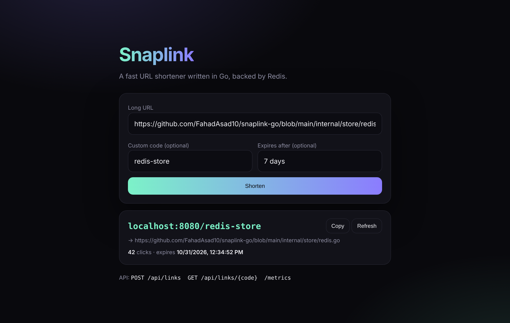

# Snaplink

**A fast, production-ready URL shortener written in Go and backed by Redis.** It ships as a ~20 MB distroless container with Prometheus metrics, per-IP rate limiting, graceful shutdown and Kubernetes manifests with autoscaling.



## Features

- **Short links** with random unambiguous codes (no `0/O`, `1/l/I`) or a custom code like `/launch`
- **Expiring links** using native Redis TTLs, so there is no cleanup job
- **Click tracking** that is atomic under load: a Lua script increments the counter only if the link exists
- **Collision-safe creation**: codes are claimed with an atomic "create if absent" script and retried on the rare collision, instead of a check-then-write race
- **Per-IP rate limiting** with token buckets (`golang.org/x/time/rate`), and idle clients are forgotten
- **Observability**: Prometheus metrics for request count, latency histograms, redirects and links created, plus JSON structured logs with `log/slog`
- **Safe input handling**: only absolute `http`/`https` URLs, size limits, unknown JSON fields rejected, reserved paths protected, and links back to the service itself refused
- **Graceful shutdown** on `SIGTERM`, so rolling deploys in Kubernetes drop no requests
- **Small web UI** embedded in the binary with `go:embed`
- **Only three runtime dependencies**: Go 1.22+ standard-library routing (`GET /{code}`) instead of a web framework

## Performance

On a single container, `hey -n 20000 -c 50` against the stats endpoint with Redis served about **13,000 requests per second** with a **p99 latency of 11 ms**.

## Quick start

```bash
docker compose up --build
```

Open http://localhost:8080, or use the API:

```bash
curl -X POST localhost:8080/api/links -d '{"url":"https://go.dev","custom_code":"go","ttl_seconds":86400}'
# {"code":"go","url":"https://go.dev","clicks":0,"created_at":"...","expires_at":"...","short_url":"http://localhost:8080/go"}

curl -i localhost:8080/go            # 302 Found, Location: https://go.dev
curl localhost:8080/api/links/go     # {"code":"go", ..., "clicks":1}
curl localhost:8080/metrics | grep snaplink_
```

Run without Docker (uses an in-memory store when `REDIS_URL` is not set):

```bash
go run ./cmd/snaplink
```

## API

| Method | Path | Description |
| --- | --- | --- |
| `POST` | `/api/links` | Create a link. Body: `url`, optional `custom_code` and `ttl_seconds` |
| `GET` | `/api/links/{code}` | Link details and click count |
| `DELETE` | `/api/links/{code}` | Delete a link |
| `GET` | `/{code}` | Redirect (302) and count the click |
| `GET` | `/healthz` | Health check, including a Redis ping |
| `GET` | `/metrics` | Prometheus metrics |

## Configuration

| Variable | Default | Description |
| --- | --- | --- |
| `ADDR` | `:8080` | Listen address |
| `BASE_URL` | `http://localhost:8080` | Public origin used to build short URLs |
| `REDIS_URL` | (unset) | e.g. `redis://redis:6379/0`. Unset means in-memory |
| `RATE_PER_MINUTE` | `30` | Link creations per IP per minute |
| `RATE_BURST` | `10` | Burst size for the rate limiter |

## Deploy to Kubernetes

```bash
kubectl apply -f deploy/k8s/
kubectl port-forward svc/snaplink 8080:80
```

The manifests include a Redis StatefulSet with a persistent volume, a two-replica Deployment with readiness and liveness probes, zero-downtime rolling updates, a hardened security context (non-root, read-only filesystem, no capabilities), Prometheus scrape annotations and a HorizontalPodAutoscaler that scales from 2 to 10 pods on CPU.

To try it on your machine, create a local cluster with [kind](https://kind.sigs.k8s.io/) or minikube first. CI publishes the image to `ghcr.io/fahadasad10/snaplink-go`.

## Tests

```bash
go test -race ./...
```

The same contract test suite runs against both the in-memory store and Redis (via [miniredis](https://github.com/alicebob/miniredis)), covering expiry, duplicate codes and 50 concurrent clicks. HTTP tests cover redirects, validation, rate limiting, metrics and the UI. CI also runs an end-to-end check against a real Redis service, then builds and pushes the Docker image.

## Project layout

```
cmd/snaplink/       main: config, wiring, graceful shutdown
internal/api/       HTTP handlers, rate limiter, metrics
internal/store/     Store interface, Redis and in-memory implementations
internal/shortid/   Code generation and validation
web/                Embedded web UI
deploy/k8s/         Kubernetes manifests
```

## Tech stack

Go 1.26 · Redis 7 · Prometheus · Docker (distroless) · Kubernetes · GitHub Actions · GHCR

## License

MIT
